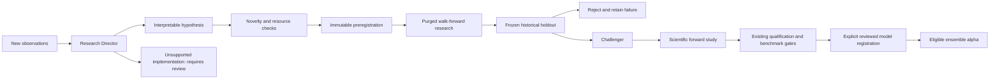

# Governed Autonomous Alpha Research Engine

TraderX can propose, preregister, execute and reject bounded quantitative hypotheses without a language model. This is a research workflow, not a chatbot or a promise of autonomous profit. The director and numerical interpreter have no order tools. Historical success produces a **CHALLENGER**, never a production recommendation.



The executable autonomous loop ends at research/challenger creation. Starting a scientific forward study is explicit. Qualification is **not** inferred from a successful backtest or a single forward study: the existing independent holdout, forward-date clusters, benchmark portfolio comparisons, regime, calibration and risk requirements still apply. There is no autonomous promotion endpoint. Admitting a new model type to the production registry is a separately reviewed versioned integration. The current automatic interpreter supports frozen Ridge-return/logistic-probability models; other existing classical/deep research remains available in its existing research tools and requires a reviewed adapter for autonomous execution.

## Use

Open **Research → Autonomous Research**. Defaults are paused, Director Off, one experiment/day, one worker, two parameter trials, 30 CPU seconds, 60 wall seconds, 768 MB monitored worker memory and 64 MB logical research storage. Resume to permit scheduled template research. New observations are reviewed no more than once every six hours; the worker then runs a bounded queued experiment and stops. Daily limits apply both to registrations and actual executions, including failures and interrupted attempts.

Pause terminates an active numerical worker at its next supervision check. A previously submitted optional text request may finish; its usage remains recorded. Pending registrations remain visible. Interrupted runs receive a permanent rejection rather than silently rerunning an inspected holdout.

Budget configuration is stored under `autonomous_research` in the existing settings store. The typed `/api/v1/research/autonomous/settings` endpoint accepts the `Budget` schema; hard caps cannot be exceeded through configuration. No real `.env` values are changed.

## Director and evidence

Deterministic observations include saved alpha/governance and dependence summaries, qualification gates, completed forward receipts, rejected experiments, historical coverage and observed news categories. Fixed interpretable templates cover momentum/volatility, reversion/liquidity, adverse news/momentum and cross-sectional momentum. Previously attempted families are not endlessly enumerated. Observations and rationale are recorded separately from results.

Director modes are Off (templates), Local or Cloud. Optional providers receive narrative research questions and category/rejection text, **not** OHLCV, ticks, P&L or risk calculations. They have no tools. The existing provider interface, permanent content/prompt/model cache, usage ledger and budget reservations apply. Global AI off wins; cloud also requires enabled automated cloud settings and available budget. Missing or rejected provider output falls back to templates. Unsupported generated specifications are quarantined for implementation review.

News inputs come only from real collected receipt timestamps. A missing collection history is unknown, not a fabricated neutral history. The current interpreter can test negative-event presence and materiality alongside supported numerical features; sparse coverage rejects the hypothesis. News's production predictive weight remains zero. No positive headline directly creates a trade.

## Constrained specification

`ExperimentSpec` forbids unknown fields. It allows at most three configured assets, six whitelisted features, three fixed horizons, identity/signed-log/past-lag transforms, the bounded Ridge/logistic family, two fixed regularization settings, after-cost or relative-return targets, a long/cash equal-weight diagnostic, cash/equal-weight benchmarks, costs, trailing liquidity requirements, and immutable minimum success criteria. There are no code, path, import, expression, broker or credential fields.

Example (remaining fields use the versioned conservative defaults):

```json
{
  "version": "autonomous-v1",
  "hypothesis": "Momentum may persist when volatility is stable and execution costs remain manageable.",
  "economic_mechanism": "Gradual information diffusion may produce persistence, while volatility shocks and turnover can erase it.",
  "lineage": "momentum-volatility",
  "universe": ["BTC-USD"],
  "asset_class": "crypto",
  "features": [{"name": "return_20"}, {"name": "regime_vol_ratio"}],
  "model_family": "ridge_logistic",
  "target": "after_cost_return",
  "horizon": 5,
  "training_window": 2000
}
```

The complete schema is exposed through the local API documentation. Parameters outside the whitelist are rejected before execution. Neural architecture proposals, new factor definitions and unsupported data transformations require review; the engine never writes or executes their proposed code.

## Registration and reproducibility

Before evaluation, append an immutable registration to the existing record store and a declaration to the existing experiment ledger. It freezes the specification, selected universe/filter metadata, source-record IDs or content-addressed archive references, dataset checksum, feature definitions, training window, chronological holdout boundary, hyperparameter bounds, cost assumptions, benchmarks, metrics, success criteria, implementation/lockfile hash, hypothesis lineage, attempt number, significance allocation and qualification criteria.

Archives are referenced in place. Training matrices are not permanently copied. Restoring a registration checks every frozen dataset hash; missing or changed data rejects the run. `Database.put` never overwrites a previous registration/result. Results and failures remain immutable, including statistically unsuccessful experiments.

Frozen means fixed **for this registration**. These historical dates may already have been examined by other research; they are not described as globally untouched. Only genuinely future observations can provide fresh independent evidence.

## Numerical evaluation

Reuse the existing causal market features, availability/expiry joins, model constructors, training-only feature selection, purged expanding walk-forward folds, and date-cluster bootstrap utilities. All declared features require sufficient training coverage. Regime and liquidity gates use prior completed observations. Prediction and calibration fit before the validation boundary. Hyperparameters are selected on three development folds, then evaluated once on the sealed chronological partition. Future holdout changes cannot select a different parameter.

Entries are delayed by two bars and use declared adverse costs against historical opens. These are research scenarios, **not reconstructed exchange fills**. Costs include fees, slippage and spread; trailing dollar volume and participation constrain eligibility. Cross-asset outcomes are grouped into nonoverlapping decision-date clusters. Prospective fills use the existing scientific forward ledger's fresh bid/ask, delay, liquidity, partial-fill, session and corporate-action safeguards.

A challenger must satisfy the frozen net/excess return, calibration, drawdown, sample, regime and temporal-stability requirements and the significance allocation. Failures classify insufficient data, weak relationship, instability, costs/turnover, calibration, redundancy, liquidity/capacity, overfitting or failed holdout. Cash is included in performance.

## Multiple testing and novelty

Each registered attempt permanently consumes index `n`; the threshold is `alpha / (n × (n+1) × trials × 2)`. The two tests are net return against cash and return above the equal-weight comparator. The allocation does not replenish after a rejection. Missing or failed results count as p=1 in the descriptive Benjamini–Yekutieli ledger adjustment. These controls cannot repair biased data, data-dependent hypothesis generation, reused historical outcomes, undocumented outside trials or invalid bootstrap assumptions. Finite bootstrap resolution can prevent later attempts from meeting a very small threshold; the engine rejects rather than enlarging its compute budget or relaxing the criteria.

Feature-family overlap, universe, target, model and economic text determine pre-execution novelty. Related lookbacks/wording inherit lineage instead of counting as new discoveries. Post-evaluation signal correlation can reject a redundant alpha. Correlation is compared only on shared dates; the compact sketch is a screening diagnostic, not a complete dependence model.

References: [SciPy false-discovery adjustment](https://docs.scipy.org/doc/scipy/reference/generated/scipy.stats.false_discovery_control.html) and [scikit-learn time-series cross-validation](https://scikit-learn.org/stable/modules/generated/sklearn.model_selection.TimeSeriesSplit.html). Chronological gaps and correction methods address different risks; neither establishes trading profitability.

## Isolation and storage

A trusted fixed interpreter runs as a low-priority subprocess with a clean environment, no broker/API keys, no database connection and no inherited input stream. It receives bounded plain JSON containing only the selected data. It cannot execute generated code. Audit hooks deny network connections, subprocesses, protected credential/database reads and writes outside its disposable directory. CPU and output-file limits are enforced by the OS; the parent monitors memory and wall time, kills over-budget workers and deletes temporary inputs/results in `finally`. This is defense in depth for trusted Python operations, not a claim that Python audit hooks constitute a general-purpose hostile native-code sandbox.

One concurrent lease is enforced transactionally. Total registration count and logical storage have hard caps; results are compact. Disk reporting excludes shared database-page/WAL overhead and already-existing historical archives. Permanent ledger/model provenance is retained; capacity exhaustion pauses new work rather than deleting evidence. Old abandoned run directories are cleaned only after the maximum lease window. No full project, dependency or archive backups are made.

Implementation ideas live under `research/proposals/auto-…/` with rationale, proposed patch **as text**, tests/data requirements and experiment design, marked REQUIRES REVIEW. This private directory is ignored by Git. Approval records human review only; it never applies, imports or runs a patch. Review both code and data requirements separately before deliberately implementing anything.

## Scope boundaries

Automatic discovery currently uses the deliberately small Ridge/logistic interpreter. Sparse event/SEC/options/macro evidence can fail coverage; the system never invents missing features. Stock/ETF current-universe and retrospective price-vintage biases are disclosed. Statistical evidence remains provisional. Automatic production promotion, arbitrary model/code generation, chatbot behavior and live trading are absent by design. The existing research, news, paper-account and risk systems continue while autonomous research is paused or AI is off.
